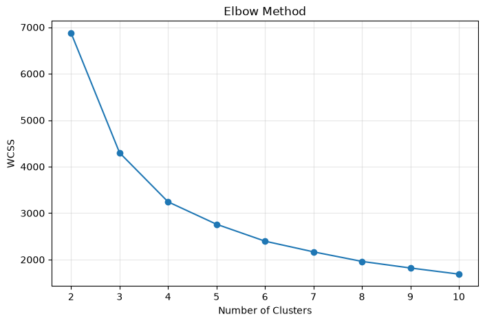
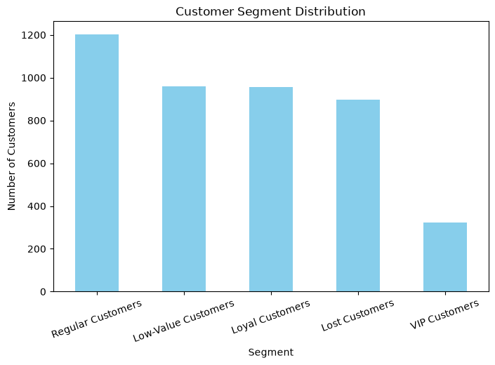
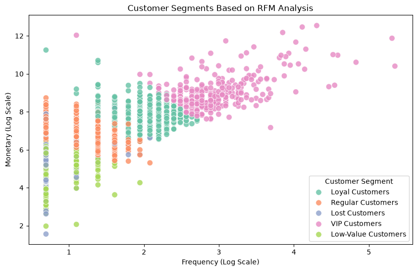

# Customer Segmentation Using RFM Analysis and K-Means Clustering
## Project Overview
This project analyzes customer purchasing behavior using the Online Retail II dataset.

The goal is to segment customers into meaningful groups based on their purchasing patterns and provide actionable business insights.

Customer segmentation was performed using:

- RFM Analysis (Recency, Frequency, Monetary)
- Data Cleaning and Feature Engineering
- K-Means Clustering
- Exploratory Data Analysis (EDA)

## Dataset
The Online Retail II dataset contains transactional records from a UK-based online retailer.

Main features:

- Invoice
- Product Information
- Quantity
- Price
- Customer ID
- Country
- Invoice Date

## Data Cleaning
The following steps were performed:

- Removed cancelled transactions
- Removed negative quantities
- Removed zero and negative prices
- Removed missing Customer IDs
- Removed duplicate records

## Data Quality Assessment
Initial inspection revealed:

- 10624 records with negative quantities
- 2 records with negative prices
- 2515 records with zero prices
- 135080 missing Customer IDs
- 5268 duplicate records

These issues were addressed before performing RFM analysis and clustering.

## Feature Engineering
A new feature called Revenue was created:

Revenue = Quantity * Price

The Revenue feature represents the monetary value of each transaction.

## RFM Analysis
Three customer metrics were calculated:

- **Recency:** Number of days since the last purchase
- **Frequency:** Number of orders
- **Monetary:** Total spending amount

## Clustering
The Elbow Method was used to determine the optimal number of clusters.

Five customer segments were identified using K-Means clustering.

## Customer Segments

|Cluster|	Segment|
|-----|----------|
|0|    Regular Customers|
|1|    Lost Customers|
|2|    VIP Customers| 
|3|    Low-Value Customers|
|4|    Loyal Customers|

## Business Insights
- Cluster 2 (VIP Customers) represents the most valuable customer segment, with the highest purchase frequency and spending levels.
- Cluster 4 (Loyal Customers) shows strong purchasing behavior and should be prioritized for retention.
- Cluster 0 (Regular Customers) may respond well to targeted marketing campaigns.
- Cluster 3 (Low-Value Customers) displays lower engagement and spending.
- Cluster 1 (Lost Customers) has not purchased for a long time and may require re-engagement strategies.

## Visualizations
- 
- 
- 

## Technologies Used
- Python
- Pandas
- NumPy
- Matplotlib
- Seaborn
- Scikit-learn
- Jupyter Notebook

## Conclusion

Using RFM Analysis and K-Means Clustering, customers were successfully segmented into five distinct groups based on purchasing behavior. The resulting segments provide valuable insights that can support marketing, retention, and customer relationship strategies.
